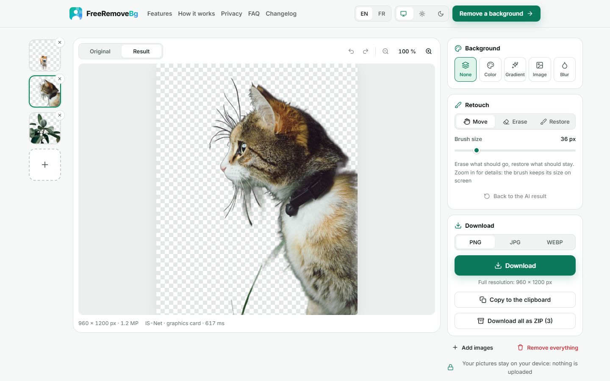
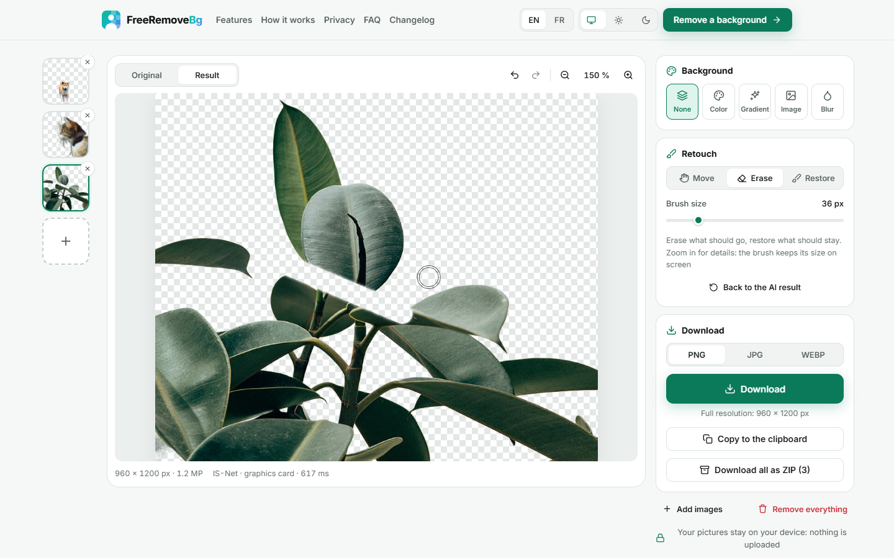
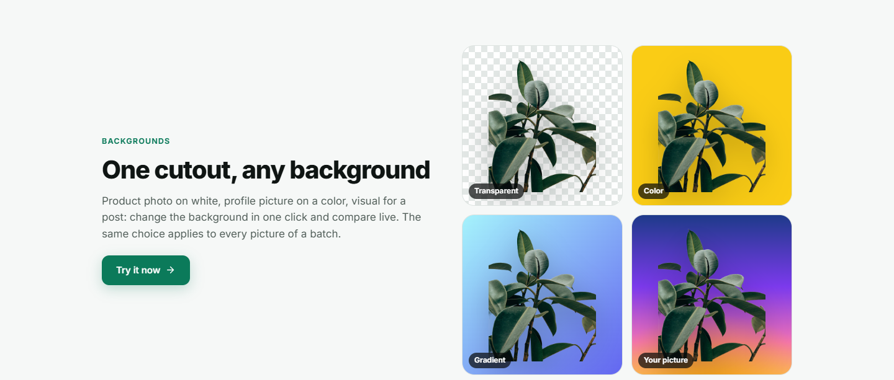
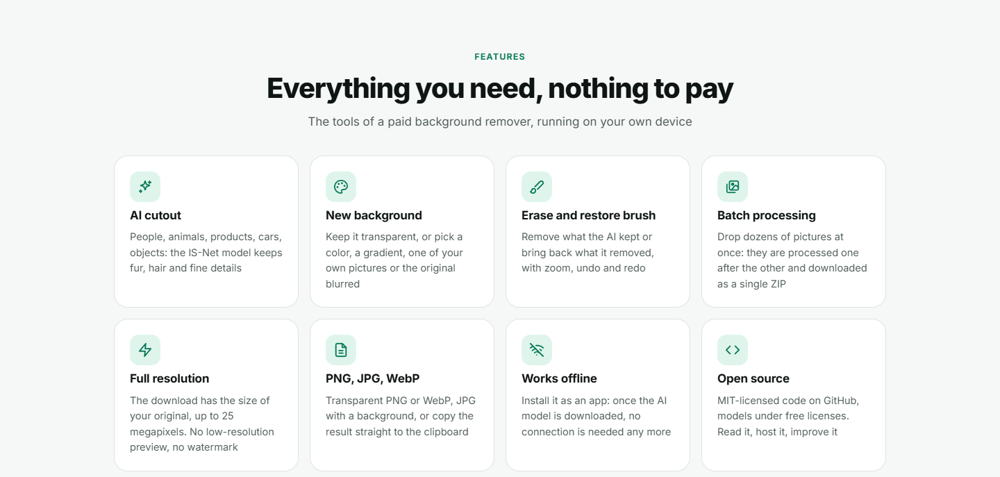
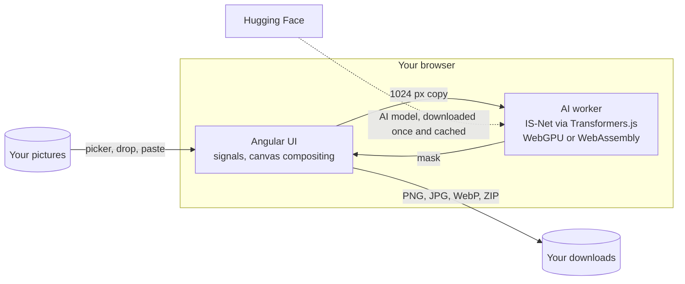

<p align="center">
  
</p>

<h1 align="center">FreeRemoveBg</h1>

<p align="center">
  <b>Remove image backgrounds. Free, private, full resolution.</b><br />
  The free, open source remove.bg alternative: an AI cuts your subject out in about a second,<br />
  running 100% in your browser. No upload, no account, no credits, no watermark.
</p>

<p align="center">
  <a href="https://freeremovebg.mbonnici.fr"><b>freeremovebg.mbonnici.fr</b></a> ·
  <a href="CHANGELOG.md">Changelog</a> ·
  <a href="https://github.com/ImMaxence/FreeRemoveBg/issues">Issues</a> ·
  <a href="LICENSE">MIT License</a>
</p>

<p align="center">
  
</p>

## Why FreeRemoveBg

| | FreeRemoveBg | Online background removers |
| --- | --- | --- |
| Full-resolution download | **Free**, up to 25 megapixels | Usually paid, by credits |
| Number of pictures | **Unlimited** | Usually limited |
| Batch processing | **Free**, one ZIP | Usually paid |
| Account | **None** | Often required |
| Your pictures | **Stay on your device** | Uploaded to a server |
| Offline | **Yes**, as an installable app | No |
| Source code | **Open** (MIT) | Closed |

The computing is done by the visitor's own graphics card or processor, so each picture costs nothing to run: that is why everything can be free.

## Features

| | |
| --- | --- |
| **AI cutout** | The IS-Net segmentation model finds the subject (people, animals, products, vehicles, objects) and keeps fur, hair and thin details. About a second per picture on a graphics card (WebGPU), a few seconds on the processor (WebAssembly). |
| **New background** | Transparent, a color (presets or your own), a gradient, one of your pictures, or the original background blurred. |
| **Erase and restore brush** | Remove what the AI kept or bring back what it removed. Zoom up to 800 %, undo / redo, and "back to the AI result". |
| **Batch processing** | Drop as many pictures as you want: they are processed one after the other, share the same background, and download as a single ZIP. |
| **Full resolution** | The result has the size of the original, up to 25 megapixels (16 on iPhone and iPad). No preview-only downloads. |
| **PNG, JPG, WebP, clipboard** | Transparent PNG or WebP, JPG with a background, or copy the result and paste it anywhere. |
| **Every way in** | File picker, drag and drop anywhere, paste with `Ctrl + V`, sample pictures, or "Open with FreeRemoveBg" once installed. |
| **Zero upload** | Pictures are read, cut out and saved by the browser, in memory. Nothing is stored, nothing is sent. |
| **PWA** | Installable, works offline once the AI model is in the browser's cache. |
| **English and French** | Each public page has its own URL (`/` and `/fr`). Light, dark and system themes. |
| **SEO, for search engines and AI** | Public pages prerendered at build time (Angular SSG) with titles, descriptions, Open Graph, canonical and `hreflang` links, schema.org data (`WebApplication`, `HowTo`, `FAQPage`). `robots.txt` open to search engines and AI crawlers, `sitemap.xml`, `llms.txt` and `llms-full.txt`, and a Markdown version of every page (`/fr/index.md`, also served for `Accept: text/markdown`). |
| **Accessibility** | The main path works with the keyboard alone, with a skip link, a visible focus, screen reader announcements of the progress, AA contrast in both themes and reduced motion. See the [accessibility statement](https://freeremovebg.mbonnici.fr/accessibility). |
| **Legal pages** | Legal notice, privacy policy, terms of use and accessibility statement, in both languages. |

## Screenshots

| Home page (light) | Home page (dark, French) |
| --- | --- |
|  |  |

| Cutout | Blurred background |
| --- | --- |
|  |  |

| Erase and restore brush | Dark theme |
| --- | --- |
|  |  |

| One cutout, any background | Features |
| --- | --- |
|  |  |

| Phone: home page | Phone: tool | Phone: menu |
| --- | --- | --- |
|  |  |  |

| Privacy policy | Changelog |
| --- | --- |
|  |  |

The screenshots are generated from a running build with `npm run screenshots`.

## How it works



- **The picture never leaves the page.** It is decoded by the browser; a 1024 px copy goes to a Web Worker, which answers with a mask.
- **The mask is a picture of its own** (up to 2048 px), which the brush edits. The result is the original, cut by the mask, over the chosen background.
- **The preview and the downloads share the same code** (`src/app/engine/compose.ts`), so what you see is what is saved, at full size.
- **Graphics card first, processor as a safety net.** If WebGPU fails (driver, memory), the worker is replaced by one that runs on WebAssembly and the picture is tried again.
- **Public pages are prerendered** in both languages at build time (`src/app/app.routes.server.ts`), then hydrated; the tool itself (`/app`) renders in the browser only.

## Privacy

- No upload, no account, no cookies, no analytics, no ads. The server keeps no access logs.
- Pictures and results live in the page's memory only: they are gone when the tab is closed.
- The production server sends a strict **Content-Security-Policy**: the page can only connect to its own origin and to Hugging Face (one-time model download). You can verify it in your browser's dev tools.
- The ONNX Runtime binaries and the font are self-hosted (no CDN).

## Browser support

| Browser | Support |
| --- | --- |
| Chrome, Edge, Opera, Brave (desktop) | Full: graphics card (WebGPU), installable app |
| Firefox | WebGPU on recent versions, processor otherwise |
| Safari | WebGPU from Safari 26 on Mac, processor otherwise |
| Android, iPhone, iPad | Works on recent devices; very large pictures may run out of memory. iPhone and iPad use the processor |

Measured on a desktop with a mid-range graphics card: about 0.5 to 2 s per picture with WebGPU, about 8 s on the processor.

## Tech stack

| Area | Choice |
| --- | --- |
| UI | Angular 22 (standalone components, zoneless, signals, prerendering with hydration), SCSS with `light-dark()` |
| i18n | Transloco (runtime language switch), JSON files in `public/i18n` |
| AI | Transformers.js + ONNX Runtime Web, [IS-Net](https://github.com/xuebinqin/DIS) general-use model ([ONNX](https://huggingface.co/BritishWerewolf/IS-Net), 179 MB) |
| Imaging | Canvas 2D compositing, `createImageBitmap`, a dependency-free ZIP writer |
| Workers | Comlink |
| PWA | `@angular/service-worker`, web app manifest with file handlers |
| Tests | Vitest (engine, translations, changelog), Playwright (key flows against the Docker build) |
| Hosting | nginx (COOP/COEP, CSP, caching) in Docker, deployed with Coolify |

There is no backend: only Angular, served as static files.

## Development

Requirements: Node.js 22.22+ or 24.15+, and Chrome or Edge to test WebGPU.

```bash
npm install
npm start            # http://localhost:4200 (COOP/COEP headers are set by the dev server)
npm run build        # production build in dist/freeremovebg/browser (public pages prerendered,
                     # then sitemap.xml, llms.txt, llms-full.txt and index.md files: scripts/seo.mjs)
npm run typecheck    # app + worker + tests
npm test             # unit tests (Vitest): the engine, and both languages have every text
npm run test:e2e     # end-to-end tests (Playwright) against http://localhost:4281
npm run check:bots   # search engines and AI crawlers get every page (online, or: -- http://localhost:4281)
npm run screenshots  # regenerates docs/screenshots from http://localhost:4281
```

The end-to-end tests run against a build (`docker compose -f docker-compose.yml -f docker-compose.local.yml up -d --build`, or `E2E_BASE_URL=http://localhost:4200` with `npm start`); the first run downloads the AI model. `npx playwright install chromium` installs their browser.

Two address parameters help when testing: `/app?device=wasm` keeps the AI on the processor, and `/app?model=<id>` imposes a model of `src/app/core/models.ts`.

Every interface text lives in `public/i18n/en.json` and `fr.json` (English is the reference): a new text goes into both, and `npm test` fails when one is missing or loses a `{{ placeholder }}`.

```text
src/app/
├── core/        state of the session (pictures, masks, background), AI models, i18n, SEO, theme, PWA
├── engine/      framework-free logic, unit-tested: mask maths, compositing, file names, ZIP
├── workers/     remove.worker (the AI), model download progress
├── editor/      the tool: preview, brush, background, download
├── landing/     home page
├── shared/      UI pieces: drop zone, icons, logo, language and theme switches
├── changelog/   renders CHANGELOG.md
└── legal/       legal notice, privacy, terms, accessibility (content in public/i18n)
e2e/             Playwright tests of the key flows
scripts/         seo.mjs (sitemap, llms.txt, Markdown pages), check-bots.mjs, screenshots.mjs
docker/          nginx configuration and security headers
```

## Deployment

The app is a static site served by nginx. The headers matter: `Cross-Origin-Opener-Policy` and `Cross-Origin-Embedder-Policy` enable multithreaded WebAssembly, and the CSP enforces the privacy promise. They are set in [`docker/headers.conf`](docker/headers.conf).

### Docker Compose (local)

```bash
docker compose -f docker-compose.yml -f docker-compose.local.yml up --build
# → http://localhost:4281
```

### Coolify

1. In Coolify, create a resource from the GitHub repository `ImMaxence/FreeRemoveBg`, branch `main`.
2. Choose the **Docker Compose** build pack, with `docker-compose.yml` as the compose file.
3. Set the domain of the `web` service to `https://freeremovebg.mbonnici.fr` (container port 80).
4. Deploy. Coolify's proxy handles HTTPS; the container exposes a `/healthz` endpoint for the health check.

The image is small (nginx and static files): the AI model is not in it. Each visitor's browser downloads it from Hugging Face, once, pinned to a commit (see [`src/app/core/models.ts`](src/app/core/models.ts)).

### After the first deployment

- Add the property `freeremovebg.mbonnici.fr` to [Google Search Console](https://search.google.com/search-console) and submit `https://freeremovebg.mbonnici.fr/sitemap.xml` (same in [Bing Webmaster Tools](https://www.bing.com/webmasters)).
- Run `npm run check:bots` to confirm that crawlers get every page through the proxy.

## Versioning

Versions follow [SemVer](https://semver.org/), `MAJOR.MINOR.PATCH`:

- **MAJOR**: a change that breaks how the app is used or hosted;
- **MINOR**: a new feature;
- **PATCH**: a fix.

The version comes from `package.json` and is shown in the site footer and on the `/changelog` page. [`CHANGELOG.md`](CHANGELOG.md) follows Keep a Changelog; it is copied into the build and rendered in the app. To release: bump `version` in `package.json`, add a section to `CHANGELOG.md`, tag `vX.Y.Z`.

## License

[MIT](LICENSE) © Maxence Bonnici. Third-party libraries and models keep their own licenses (IS-Net model: Apache-2.0, Transformers.js and Comlink: Apache-2.0, ONNX Runtime, Angular and Transloco: MIT, Inter font: OFL). The sample pictures are in the public domain (CC0): see [`public/samples/CREDITS.md`](public/samples/CREDITS.md).

remove.bg is a trademark of its owner. FreeRemoveBg is an independent project, not affiliated with remove.bg or its publisher.
