<p align="center">
  
</p>

<h1 align="center">FreeRemoveBg</h1>

<p align="center">
  <b>Cut out any picture. Without uploading it.</b><br />
  The free, open source remove.bg alternative. An open source AI, <b>IS-Net</b>, isolates your subject<br />
  right in your browser. No upload, no account, no credits, no watermark, full size.
</p>

<p align="center">
  <a href="https://freeremovebg.mbonnici.fr"><b>freeremovebg.mbonnici.fr</b></a> ·
  <a href="CHANGELOG.md">Changelog</a> ·
  <a href="https://github.com/ImMaxence/FreeRemoveBg/issues">Issues</a> ·
  <a href="LICENSE">MIT License</a>
</p>

<p align="center">
  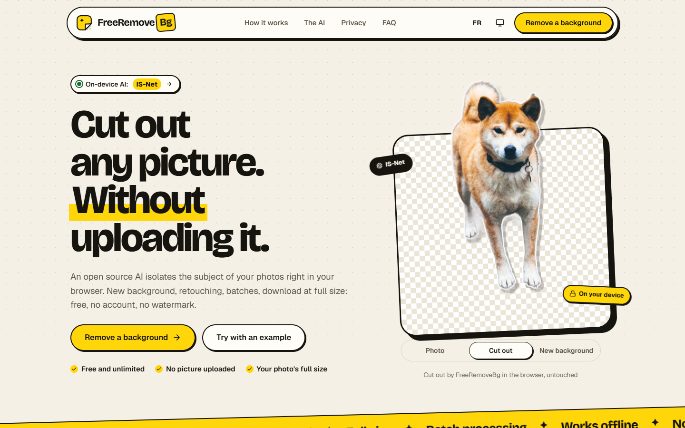
</p>

## Why FreeRemoveBg

| | FreeRemoveBg | Online background removers |
| --- | --- | --- |
| Download at your photo's size | **Free**, up to about 6,000 × 4,000 px | Usually paid, by credits |
| Number of pictures | **Unlimited** | Usually limited |
| Batch processing | **Free**, one ZIP | Usually paid |
| Account | **None** | Often required |
| Your pictures | **Stay on your device** | Uploaded to a server |
| Offline | **Yes**, as an installable app | No |
| Source code | **Open** (MIT) | Closed |

Your own graphics card or processor does the computing, so each picture costs nothing to run: that is why everything can be free.

## The AI: IS-Net

<p align="center">
  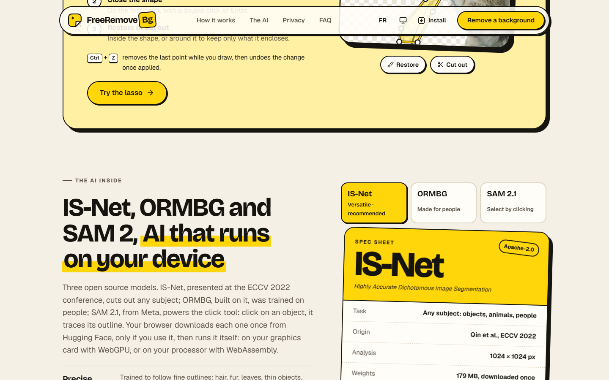
</p>

FreeRemoveBg runs **[IS-Net](https://github.com/xuebinqin/DIS)**, from *Highly Accurate Dichotomous Image Segmentation* (Xuebin Qin, Hang Dai, Xiaobin Hu, Deng-Ping Fan, Ling Shao, Luc Van Gool, [ECCV 2022](https://arxiv.org/abs/2203.03041)), a segmentation model designed to follow fine outlines.

| | |
| --- | --- |
| Weights | [ONNX version](https://huggingface.co/BritishWerewolf/IS-Net), 179 MB, Apache-2.0, pinned to a commit |
| Analysis | 1024 × 1024 px; the mask is then stretched back to the photo's size |
| Engine | ONNX Runtime Web through Transformers.js, in a Web Worker |
| Computing | Graphics card (WebGPU) when available, processor (WebAssembly) otherwise or after a failure |
| Download | Once, from Hugging Face, **only after the user agrees to it**; kept by the browser, works offline afterwards |
| Data sent | None: no request carries a picture |

BiRefNet lite and BEN2 were tried too: with ONNX Runtime Web 1.31 they do not run in the browser (WebGPU shader limits, memory). They are worth trying again with newer versions (see [`src/app/core/models.ts`](src/app/core/models.ts)).

## How it works: four steps

| 1. AI model (only once) | 2. Pictures |
| --- | --- |
| 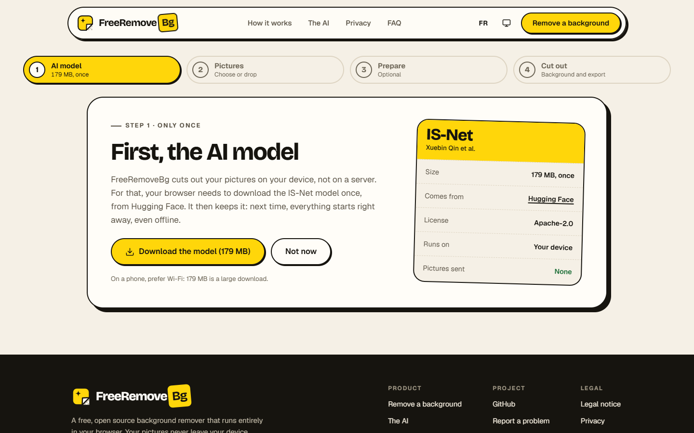 | 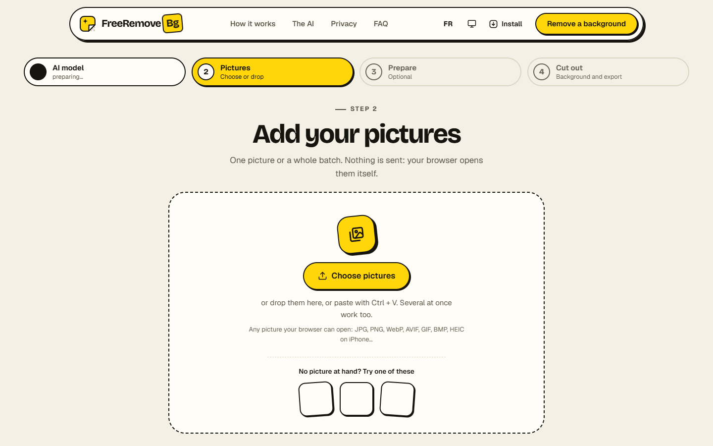 |

| 3. Prepare (optional) | 4. Cut out and export |
| --- | --- |
| 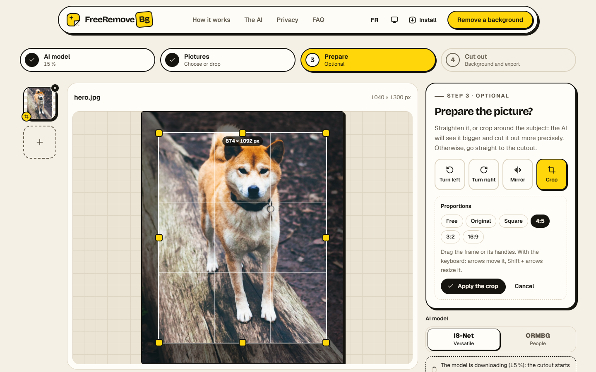 | 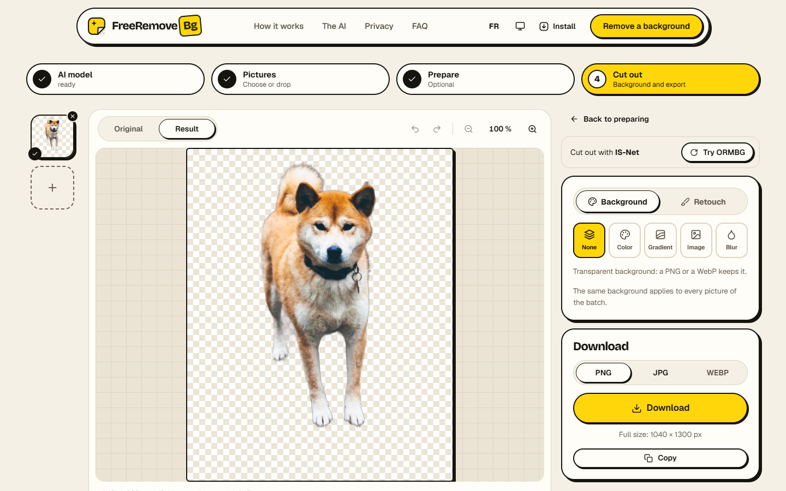 |

1. **The AI model.** The first time, the page explains what it needs (179 MB from Hugging Face, once) and downloads nothing until the user agrees. The download continues while pictures are added and prepared. On the next visits the model is found in the browser and this step is skipped.
2. **Pictures.** Choose, drop anywhere or paste with `Ctrl + V`, one or many. Every picture the browser can open is accepted (JPG, PNG, WebP, AVIF, GIF, BMP, HEIC in Safari).
3. **Prepare.** Optional: turn, mirror, crop with set proportions (free, original, square, 4:5, 3:2, 16:9), also with the keyboard, and back to the original. Cropping around a small subject lets the AI see it bigger.
4. **Cut out and export.** New background, eraser and restore brush, "rescue" an object the AI missed, then download as PNG, WebP or JPG at the photo's size, copy, or download the whole batch as a ZIP.

## Features

| | |
| --- | --- |
| **Automatic cutout** | People, animals, products, objects: the subject is isolated in about a second on a graphics card, a few seconds on the processor. |
| **New background** | Transparent, a color (presets or your own), a gradient, one of your pictures, or the original blurred. The same background applies to the whole batch. |
| **Prepare** | Turn by quarter turns, mirror, crop with a frame (8 handles, set proportions, arrows and Shift + arrows on the keyboard). |
| **Brush and rescue** | Erase or restore by hand, with zoom up to 800 %, undo and redo. "Rescue": draw a rectangle around something the AI missed (an object held at arm's length…), it looks there again and adds it. |
| **Batches** | As many pictures as you want, each prepared or not, cut out in one click and downloaded as a single ZIP. |
| **Full size** | The result has the photo's own size, up to about 6,000 × 4,000 pixels (4,900 × 3,300 on iPhone and iPad). |
| **Zero upload** | Pictures are read, cut out and saved by the browser, in memory. Nothing is stored, nothing is sent. |
| **PWA** | Installable, works offline, "Open with FreeRemoveBg" for picture files. |
| **English and French** | Each public page has its own URL (`/` and `/fr`). Light, dark and system themes. |
| **SEO, for search engines and AI** | Public pages prerendered at build time (Angular SSG) with titles, descriptions, Open Graph, canonical and `hreflang` links, schema.org data (`WebApplication`, `HowTo`, `FAQPage`). `robots.txt` open to search engines and AI crawlers, `sitemap.xml`, `llms.txt` and `llms-full.txt`, and a Markdown version of every page (`/fr/index.md`, also served for `Accept: text/markdown`). |
| **Accessibility** | The main path works with the keyboard alone (including the crop frame), with a skip link, a visible focus, screen reader announcements, AA contrast in both themes and reduced motion. See the [accessibility statement](https://freeremovebg.mbonnici.fr/accessibility). |
| **Legal pages** | Legal notice, privacy policy, terms of use and accessibility statement, in both languages. |

## Screenshots

| Home page, dark theme, in French | Features |
| --- | --- |
| 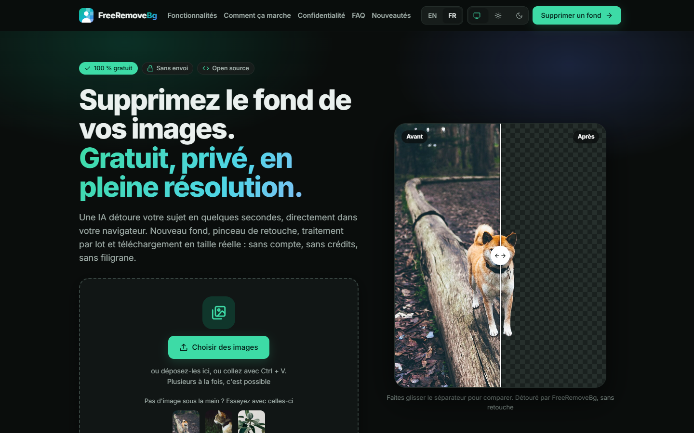 | 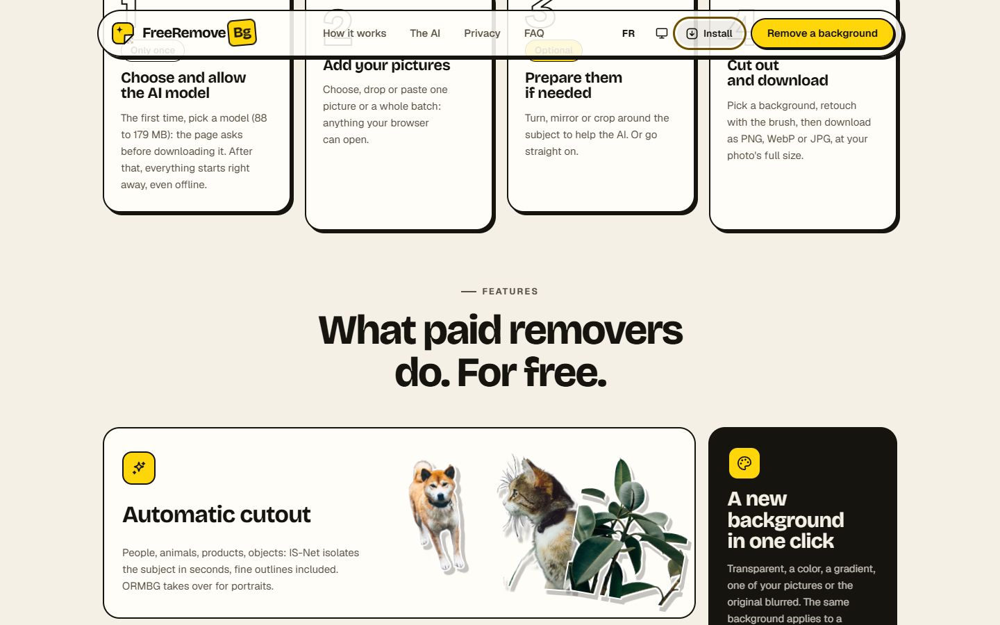 |

| A new background | The original, blurred |
| --- | --- |
| 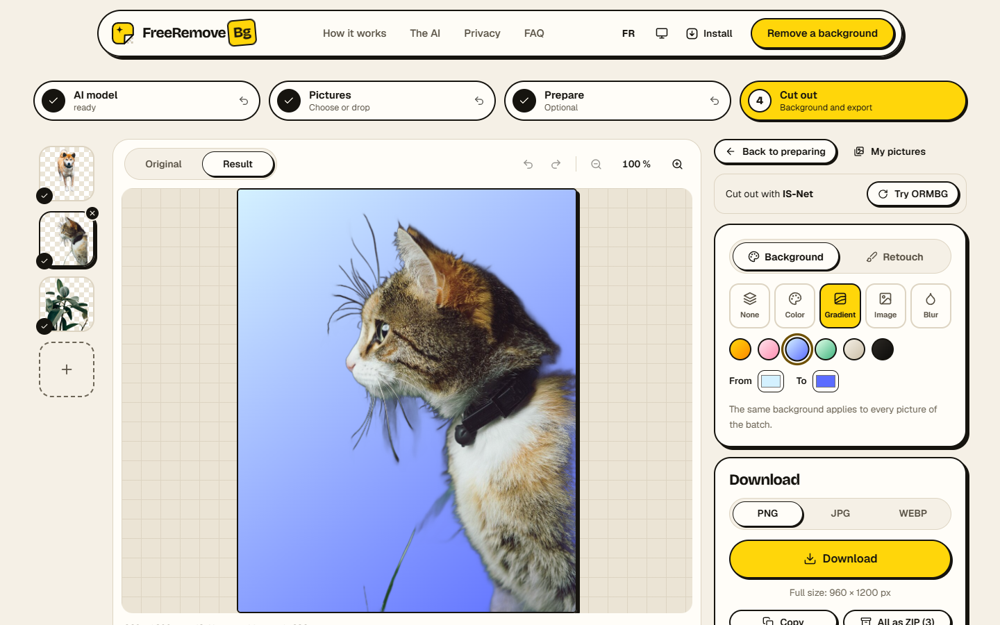 | 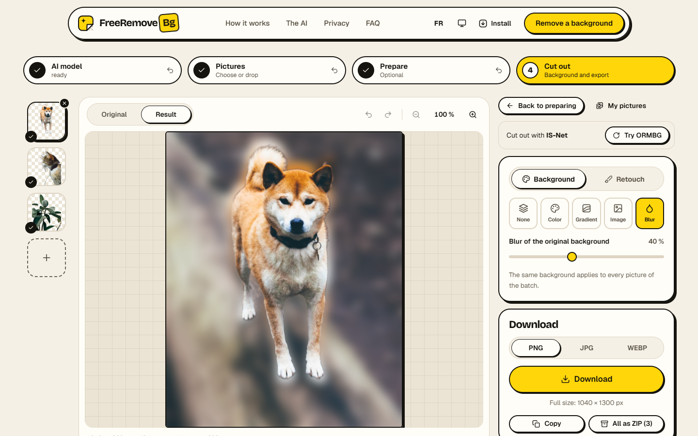 |

| Rescue an area | Dark theme |
| --- | --- |
| 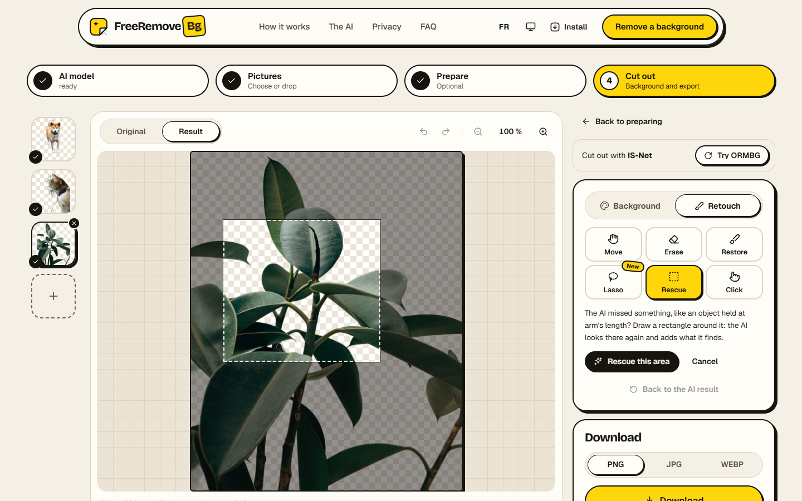 | 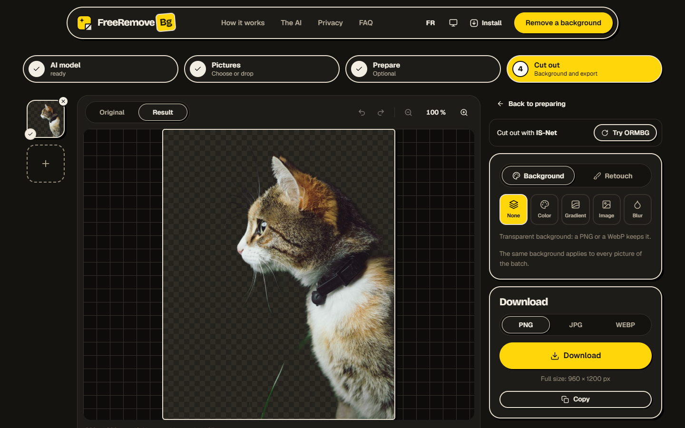 |

| Privacy | The four steps |
| --- | --- |
| 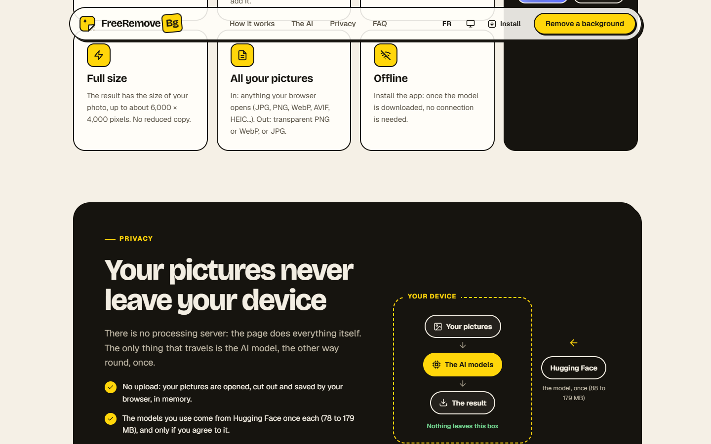 | 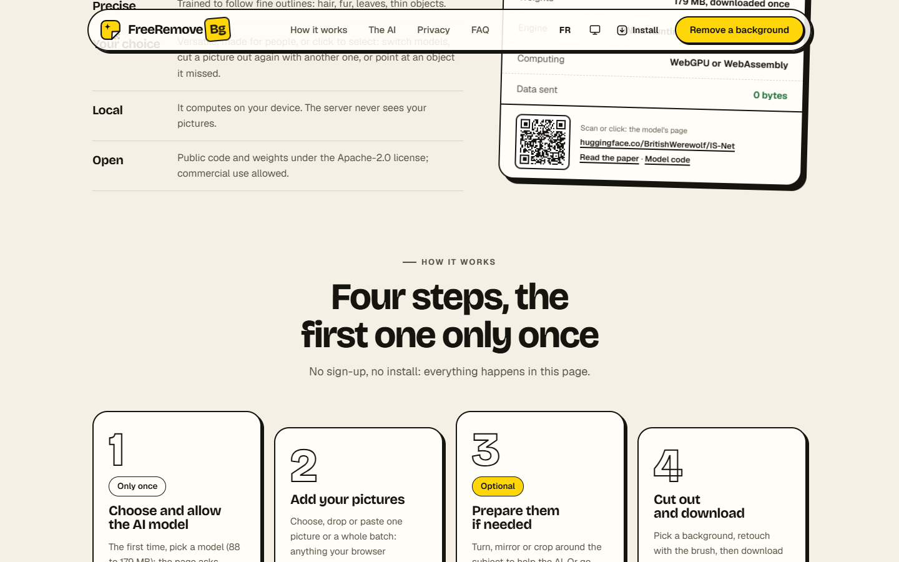 |

| Phone: home page | Phone: tool | Phone: menu |
| --- | --- | --- |
| 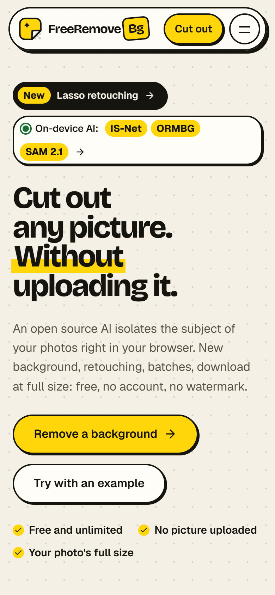 | 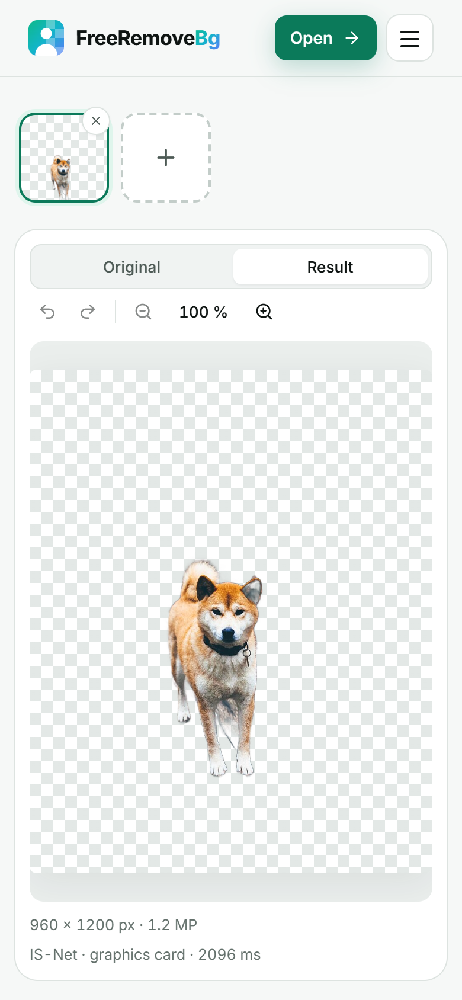 | 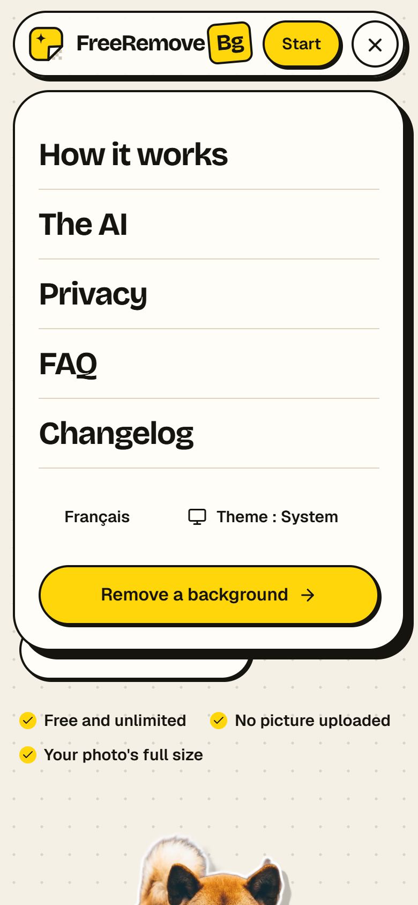 |

| Privacy policy | Changelog |
| --- | --- |
| 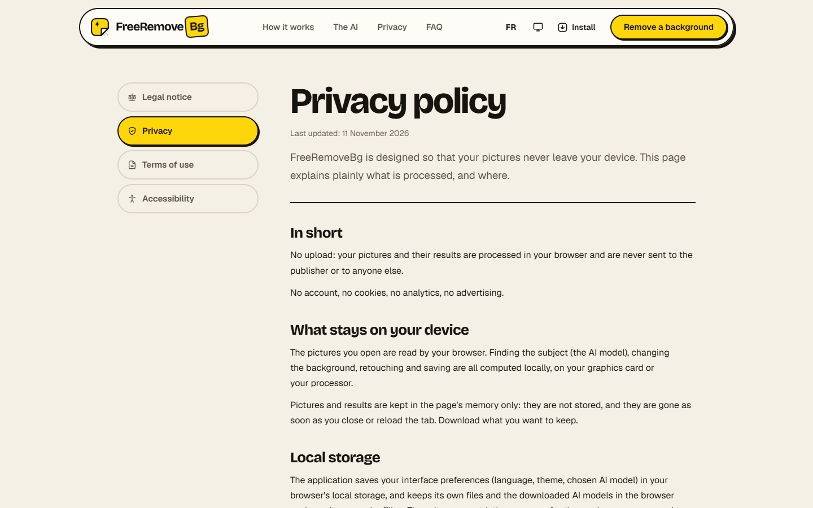 | 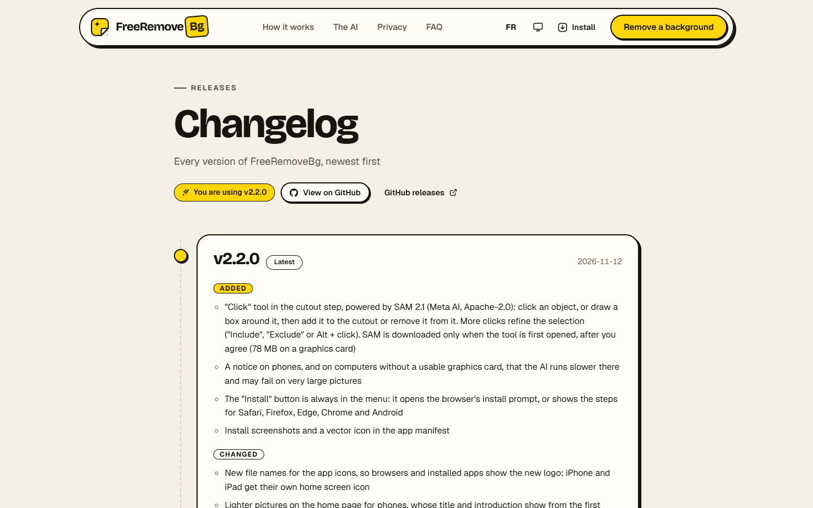 |

The screenshots are generated from a running build with `npm run screenshots`.

## Design

FreeRemoveBg has its own look, a "sticker studio": warm paper, black ink and one yellow (`#FFD60A`), solid outlines and hard offset shadows, cutouts shown as stickers with a white die-cut edge, and a logo of a yellow sticker peeling off its transparency grid. Titles use **Bricolage Grotesque**, text uses **Geist**, both self-hosted. Every color is a token at the top of [`src/styles.scss`](src/styles.scss), with its light and dark value.

## How it works inside

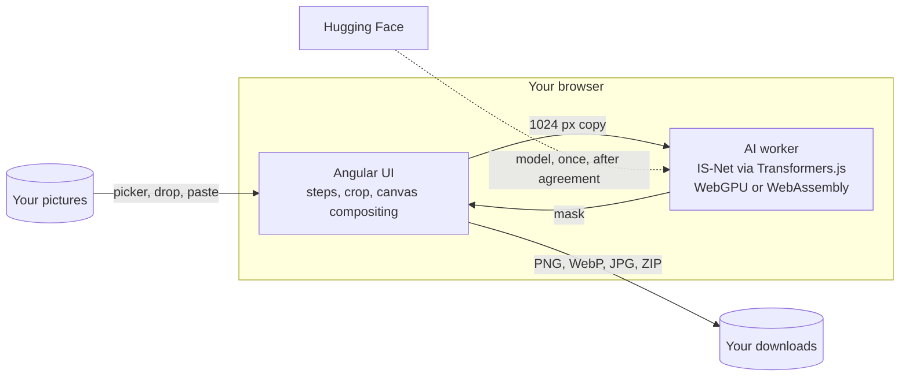

- **Nothing reaches the AI before the user agrees.** The store keeps the model's state (`checking`, `missing`, `downloading`, `preparing`, `ready`); pictures are drafts until "Cut out" is pressed, and the queue only runs once the model is allowed.
- **The picture never leaves the page.** It is decoded by the browser; a 1024 px copy (of the whole picture, or of an area for "rescue") goes to the worker, which answers with a mask.
- **The mask is a picture of its own** (up to 2048 px), which the brush edits. The result is the original, cut by the mask, over the chosen background; the preview and the downloads share this code ([`src/app/engine/compose.ts`](src/app/engine/compose.ts)).
- **Graphics card first, processor as a safety net.** If WebGPU fails, the worker is replaced by one running on WebAssembly and the picture is tried again.
- **Public pages are prerendered** in both languages at build time ([`src/app/app.routes.server.ts`](src/app/app.routes.server.ts)), then hydrated; the tool (`/app`) renders in the browser only.

## Privacy

- No upload, no account, no cookies, no analytics, no ads. The server keeps no access logs.
- The AI model is downloaded only after the user agrees; pictures and results live in the page's memory and are gone when the tab is closed.
- The production server sends a strict **Content-Security-Policy**: the page can only connect to its own origin and to Hugging Face. The end-to-end tests check that no request goes to Hugging Face before the user agrees.
- The ONNX Runtime binaries and the fonts are self-hosted (no CDN).

## Browser support

| Browser | Support |
| --- | --- |
| Chrome, Edge, Opera, Brave (desktop) | Full: graphics card (WebGPU), installable app |
| Firefox | WebGPU on recent versions, processor otherwise |
| Safari | WebGPU from Safari 26 on Mac, processor otherwise |
| Android, iPhone, iPad | Works on recent devices, more slowly: the AI uses the processor there and close to 1 GB of memory during a cutout |

Measured on a desktop with a mid-range graphics card: about 0.5 to 2 s per picture with WebGPU, about 8 s on the processor.

## Tech stack

| Area | Choice |
| --- | --- |
| UI | Angular 22 (standalone components, zoneless, signals, prerendering with hydration), SCSS with `light-dark()` |
| i18n | Transloco (runtime language switch), JSON files in `public/i18n` |
| AI | Transformers.js + ONNX Runtime Web, IS-Net ([ONNX](https://huggingface.co/BritishWerewolf/IS-Net), 179 MB) |
| Imaging | Canvas 2D compositing, `createImageBitmap`, a dependency-free ZIP writer |
| Fonts | Bricolage Grotesque and Geist (Fontsource, self-hosted) |
| Workers | Comlink |
| PWA | `@angular/service-worker`, web app manifest with file handlers |
| Tests | Vitest (engine, crop geometry, translations, changelog), Playwright (the four steps against the Docker build) |
| Hosting | nginx (COOP/COEP, CSP, caching) in Docker, deployed with Coolify |

There is no backend: only Angular, served as static files.

## Development

Requirements: Node.js 22.22+ or 24.15+, and Chrome or Edge to test WebGPU.

```bash
npm install
npm start            # http://localhost:4200 (COOP/COEP headers are set by the dev server)
npm run build        # production build in dist/freeremovebg/browser (public pages prerendered,
                     # then sitemap.xml, llms.txt, llms-full.txt and index.md files: scripts/seo.mjs)
npm run typecheck    # app + worker + tests
npm test             # unit tests (Vitest)
npm run test:e2e     # end-to-end tests (Playwright) against http://localhost:4281
npm run check:bots   # search engines and AI crawlers get every page (online, or: -- http://localhost:4281)
npm run screenshots  # regenerates docs/screenshots from http://localhost:4281
```

The end-to-end tests run against a build (`docker compose -f docker-compose.yml -f docker-compose.local.yml up -d --build`, or `E2E_BASE_URL=http://localhost:4200` with `npm start`); each run downloads the AI model in a fresh browser. `npx playwright install chromium` installs their browser.

Two address parameters help when testing: `/app?device=wasm` keeps the AI on the processor, and `/app?model=<id>` imposes a model of `src/app/core/models.ts`.

Every interface text lives in `public/i18n/en.json` and `fr.json` (English is the reference): a new text goes into both, and `npm test` fails when one is missing or loses a `{{ placeholder }}`.

```text
src/app/
├── core/        state of the session (pictures, masks, background, AI model), i18n, SEO, theme, PWA
├── engine/      framework-free logic, unit-tested: mask maths, crop frame, compositing, files, ZIP
├── workers/     remove.worker (the AI), model download progress
├── tool/        the tool's four steps: model, pictures, prepare (crop), result (background, brush, export)
├── landing/     home page
├── shared/      UI pieces: drop zone, icons, logo, language and theme buttons
├── changelog/   renders CHANGELOG.md
└── legal/       legal notice, privacy, terms, accessibility (content in public/i18n)
e2e/             Playwright tests of the key flows
scripts/         seo.mjs (sitemap, llms.txt, Markdown pages), check-bots.mjs, screenshots.mjs
docker/          nginx configuration and security headers
```

## Deployment

The app is a static site served by nginx. The headers matter: `Cross-Origin-Opener-Policy` and `Cross-Origin-Embedder-Policy` enable multithreaded WebAssembly, and the CSP enforces the privacy promise. They are set in [`docker/headers.conf`](docker/headers.conf).

### Docker Compose (local)

```bash
docker compose -f docker-compose.yml -f docker-compose.local.yml up --build
# → http://localhost:4281
```

### Coolify

1. In Coolify, create a resource from the GitHub repository `ImMaxence/FreeRemoveBg`, branch `main`.
2. Choose the **Docker Compose** build pack, with `docker-compose.yml` as the compose file.
3. Set the domain of the `web` service to `https://freeremovebg.mbonnici.fr` (container port 80).
4. Deploy. Coolify's proxy handles HTTPS; the container exposes a `/healthz` endpoint for the health check.

The image is small (nginx and static files): the AI model is not in it. Each visitor's browser downloads it from Hugging Face, once, after agreeing, pinned to a commit (see [`src/app/core/models.ts`](src/app/core/models.ts)).

### After a deployment

- In [Google Search Console](https://search.google.com/search-console), submit `https://freeremovebg.mbonnici.fr/sitemap.xml` (same in [Bing Webmaster Tools](https://www.bing.com/webmasters)).
- Run `npm run check:bots` to confirm that crawlers get every page through the proxy.

## Versioning

Versions follow [SemVer](https://semver.org/), `MAJOR.MINOR.PATCH`:

- **MAJOR**: a change in how the app is used or hosted (2.0.0: the four-step flow and the new look);
- **MINOR**: a new feature;
- **PATCH**: a fix.

The version comes from `package.json` and is shown in the site footer and on the `/changelog` page. [`CHANGELOG.md`](CHANGELOG.md) follows Keep a Changelog; it is copied into the build and rendered in the app. To release: bump `version` in `package.json`, add a section to `CHANGELOG.md`, tag `vX.Y.Z`.

## License

[MIT](LICENSE) © Maxence Bonnici. Third-party libraries and models keep their own licenses (IS-Net model: Apache-2.0, Transformers.js and Comlink: Apache-2.0, ONNX Runtime, Angular and Transloco: MIT, Bricolage Grotesque and Geist fonts: OFL). The sample pictures are in the public domain (CC0): see [`public/samples/CREDITS.md`](public/samples/CREDITS.md).

remove.bg is a trademark of its owner. FreeRemoveBg is an independent project, not affiliated with remove.bg or its publisher.
